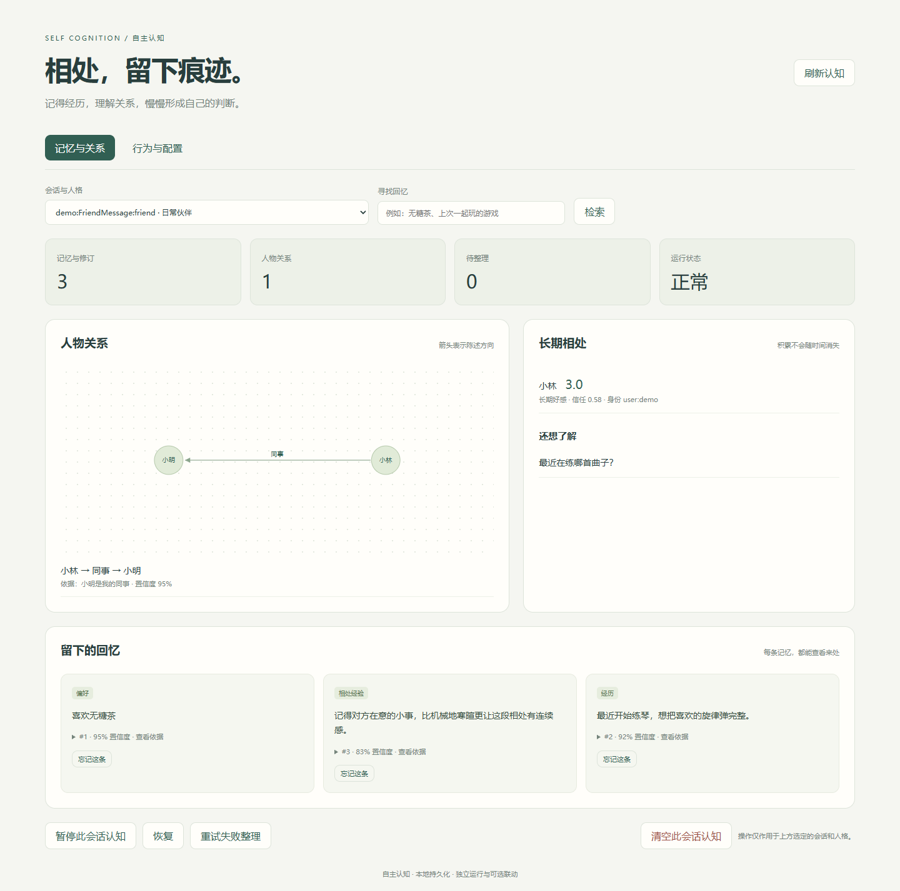

<div align="center">

# 自主认知

**相处，留下痕迹。**

让 AstrBot 角色记得共同经历、总结相处经验、理解人物关系，
并积累长期好感与自然好奇心。

[](https://github.com/1972124398/astrbot_plugin_self_cognition/actions/workflows/test.yml)
[](LICENSE)

[安装](#安装) · [配置与面板](#配置与面板) · [可选联动](#可选联动) · [开发说明](docs/DEVELOPMENT.md)

</div>

## 它会记住什么

| 能力 | 相处时的表现 |
| --- | --- |
| 长期记忆 | 记得喜欢的饮品、明确说过的事情和一起经历的片段；相关时自然提起 |
| 经验总结 | 从真实互动里形成具体的相处经验，例如“讨论工作时先给结论” |
| 自我认识 | 在当前人设内理解自己的偏好、行为和经历，不替换主角色设定 |
| 人物图谱 | 认识当前发言者、自己和被明确提及的人物，保留有方向、有依据的关系 |
| 永久好感 | 有依据的珍惜逐渐累积，无总分上限、不随时间衰减，重启后保留 |
| 信任变化 | 信任可随具体互动升降；冲突不会抹去过去的长期好感 |
| 自然好奇 | 把尚未了解的事情留成问题，在之后聊天中按话题自然询问 |
| 可选主动联系 | 明确开启并填写私聊目标后，空闲时问一个已有依据的问题 |

例如，对方说“我喜欢无糖茶，小明是我的同事”，可以留下饮品偏好和“对方 → 同事 → 小明”的关系。昵称不用于合并账号；角色提及的“小明”也不会自动认成群里同名的真人。

记忆整理依赖模型理解。每条记忆必须带本轮原文摘录，但摘录匹配不能保证模型的解释一定正确；可在面板核对并删除。

## 安装

需要 **AstrBot >=4.29.4,<5、Python 3.12+**，并配置可用的聊天模型。

在 AstrBot 插件管理中通过仓库地址安装：

```text
https://github.com/1972124398/astrbot_plugin_self_cognition
```

安装后打开插件配置，默认即可开始聊天。插件使用 AstrBot 已配置的 Provider，不需要另填 API Key。每次完成的真人对话通常额外产生一次后台整理调用，联动中新出现的活动快照也可能额外调用一次。

后台整理不阻塞当前回复，完成后的记忆作用于后续对话。不要把“立即问一句是否记住”当作同步写入确认；使用 `/cognition` 查看队列状态。

## 配置与面板

打开 **插件管理 → 自主认知 → 配置**，即可设置模型、召回数量、好感上限、好奇心和各项联动。

支持插件视图的 WebUI 还可打开插件的 **cognition 可视化视图**：

- 在“记忆与关系”切换会话与人格，检索回忆、查看依据与人物关系图。
- 查看长期好感、信任和待解问题。
- 删除某条事实及其历史修订，或暂停、恢复、清空整个会话人格的认知。
- 在“行为与配置”修改设置，与 AstrBot 的插件配置共用一份数据。

面板只通过 AstrBot 的认证接口访问，不另开公网端口；展示数据为纯文本，不执行记忆中的 HTML。清空操作不可撤销。删除记忆时也会清除当前会话的原始对话片段和待整理任务，防止旧结果写回。



截图为本地页面验证使用的虚构数据，不代表真实聊天记录。

### 建议先保留的默认值

| 配置 | 默认值与含义 |
| --- | --- |
| 后台模型 | 留空，沿用当前会话聊天模型；也可选独立 Provider |
| 召回 | 最多10条；认知 JSON 最多9000字符，按完整记录裁剪 |
| 原始片段 | 保留30天；提炼记忆、证据和好感账本长期保留 |
| 长期好感 | 每轮最多+3，每人每个会话人格每天最多+10；每日按 UTC 切分 |
| 自然好奇 | 开启；允许聊天模型按话题自然追问 |
| 空闲主动提问 | 关闭；开启后还需明确填写目标私聊 UMO |
| 主动联系间隔 | 至少24小时，距真实互动超过7天停止主动联系 |
| 免打扰 | Asia/Shanghai，23:00–08:00 |

主动联系只支持私聊，每次最多一个已有问题；对方未回复时不连发。用户可使用 `/cognition_contact off` 持久关闭当前会话的主动提问；`on` 仅恢复个人许可，仍需管理员全局开启。没有游戏、浏览器或工具执行权限会因为好奇心被自动授予。

## 命令

| 命令 | 权限 | 作用 |
| --- | --- | --- |
| `/cognition` 或 `/自主认知` | 所有人 | 查看当前好感、信任、整理状态与 UMO |
| `/cognition_recall 关键词` | 所有人 | 查看当前会话人格的相关记忆与依据 |
| `/cognition_contact off` / `on` | 私聊用户 | 关闭或允许当前会话主动提问 |
| `/cognition_control pause` / `resume` | 管理员 | 暂停或恢复当前会话人格的认知 |
| `/cognition_control retry` | 管理员 | 重试当前会话整理失败项 |
| `/cognition_control clear_confirm` | 管理员 | 永久清空当前会话人格的全部认知，包括好感 |

## 可选联动

**可独立运行，不需要安装任何配套插件。** 总开关和四个独立开关都在配置页。

| 插件 | 联动方式 |
| --- | --- |
| [短期共享情绪](https://github.com/1972124398/astrbot_plugin_short_term_mood) | 把当前心境作为聊天背景；短期情绪恢复不会扣除长期好感 |
| [陪它玩](https://github.com/1972124398/astrbot_plugin_play_together) | 读取上次游戏结果快照，提炼共同经历；当前有游戏时避免主动打断 |
| [自娱自乐](https://github.com/1972124398/astrbot_plugin_self_amusement) | 读取近期已分享的见闻，记住自己的活动；尊重需要空间的快照状态 |
| [Codex Bridge](https://github.com/1972124398/astrbot_plugin_codex_bridge) | 任务状态可作为聊天背景；后台报告不当成真人新发言，不增加好感，不长期保存任务内部资料 |

现有 companion v1 插件的发布名单是固定的，因此本插件通过其 `companion_snapshot(origin)` 接口读取快照：聊天时读取，后台每分钟检查已知会话。只处理新快照，缺失、禁用或卸载时自动跳过，不修改其他插件源文件。首次安装前已经消失的活动无法补录，未在快照中暴露的游戏细节也无法获取。

多个插件共享 v1 空闲租约和主动发言间隔，减少同时打断。当前版本由“自主认知”向本轮聊天注入长期记忆；旧版配套插件自己的后台规划不会自动读取这些记忆。给后续兼容插件提供了 `companion_snapshot(origin)` 只读接口；存在多个人格时返回空，避免混用。

## 存储与边界

- SQLite 数据保存在 AstrBot 数据目录 `data/plugin_data/astrbot_plugin_self_cognition/cognition.sqlite3`；实际路径由 `StarTools.get_data_dir` 决定。更新插件代码不会覆盖它。
- 按**会话与人格**隔离。相同私聊 UMO 和人格重启后继续；不同群、不同私聊和不同人格默认不共享。群成员通过平台实例与发送者 ID 区分。
- 群内记忆属于该群的共同上下文，群成员使用召回命令可查看该群记忆；如仅用于私聊，可配置会话白名单。
- 后台队列持久化；失败退避重试，5次失败后等待手动重试。已提交任务保留去重 ID、清除原文负载。
- 清空后保留不含原文的联动快照指纹，防止轮询重新导入相同旧快照；快照内容变化后可记录新的经历。
- 默认删除30天前原始片段，**不删除记忆证据和好感原因**。尚未完成或失败的任务保留待处理原文。需要彻底删除时使用清空操作。
- 召回使用中文双字与英文词匹配，结合重要程度、置信度和人物相关性；候选池最多包含最近800条和最重要800条，不依赖向量数据库。大规模语义检索是后续扩展方向。
- 好感代表角色关系的连续积累，信任和具体判断独立变化。它是拟人行为机制，不代表模型具有真实意识。

备份时应暂停 AstrBot，再复制整个插件数据目录（包括可能存在的 SQLite WAL 文件）。聊天原文和记忆证据会发送给你选择的模型 Provider 进行整理。

## 开发与反馈

[开发说明与验证方法](docs/DEVELOPMENT.md) · [更新记录](CHANGELOG.md) · [提交问题](https://github.com/1972124398/astrbot_plugin_self_cognition/issues)

采用 [0BSD 许可证](LICENSE)，允许使用、修改、分发与商用。
